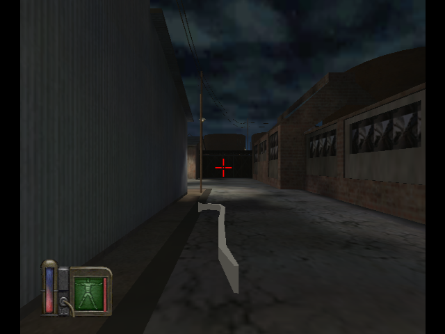

# Isolated m1l2b WorldDL cache comparison — 2026-11-22

Two 60-second Dolphin captures now verify the same m1l2b smoke route with the same engine source revision and a one-line scratch change to the WorldDL chunk-cache retention cap. The captures used the same local Dolphin binary and the probe script's isolated profile/configuration; no other Dolphin process was running. The resulting captures verify render behavior and memory/texture-slot allocation, not a speedup: this build has no frame-time profiler enabled.

## Builds and runs

| Run | ISO SHA-256 | DOL SHA-256 | WorldDL cache | Runtime result |
| --- | --- | --- | ---: | --- |
| Control | `e26b3d3a40ded2bfaaa6ba3a717a2eb737319676bf655727af36ac55d5f12517` | `267d97e80c9dc90c9d70b1bf4bf1a49f6c7de14ff74f62f92a9ababf944bfa7c` | 192 KiB | `gcmap smoke frames ready`; `newgame world render ready`; props draw |
| Candidate | `b709563385cab39d9274e5728bfe9964555c38e55a561382a1b2011153dd5af2` | `0c3ceb53b629cd596d11d3d91fbed992066b3e1309b9a5042735a5c1efbe8703` | 128 KiB | same readiness markers and prop draw |

Both DOLs were built from Xash3D-GC `62a3a6a3a912e1d45db4e1516f8d722c3256944a`. The shared Dolphin executable SHA-256 was `2d443e479044748c10651e472c30204b4dcb1ff11c914f7dff5fa51d6e222782`; the candidate changes `keep = Q_min( keep, 192u * 1024u );` to `keep = Q_min( keep, 128u * 1024u );` in `ref/gx/r_gx_worlddl.c`. Full build records are [control engine build](control-engine-build.log) / [control disc build](control-disc-build.log) and [candidate engine build](candidate-engine-build.log) / [candidate disc build](candidate-disc-build.log). The exact one-line scratch change is [worlddl-cache-cap.patch](worlddl-cache-cap.patch).

## Runtime observations

- Both captures loaded `m1l2b`, reached the render-ready markers, and drew the same prop workload: horizon `1890` triangles / `27` instances and near props `988` triangles / `44` instances.
- Control: widest PVS `1139 KiB`, chunk cache `192 KiB`, `11 × 10,944`-byte tail slots, no `21,984`-byte slot; chunk-ring peak `633 of 170 KiB`.
- Candidate: widest PVS `1139 KiB`, chunk cache `128 KiB`, `15 × 10,944`-byte tail slots and `1 × 21,984`-byte slot; chunk-ring peak `633 of 106 KiB`.
- This gave the candidate four additional small slots plus one larger slot while retaining gameplay-map render readiness and props. The periodic hit/miss counters vary between snapshots; they are not comparable frame-time measurements and do not establish a performance gain.

The first capture was launched with a route label ending in `128k-candidate` by mistake, but the disc hash is the 192 KiB control ISO. This was caught before archiving; the file is named `control-192k-dolphin.log` here. The correct 128 KiB ISO was then captured in the second run. No gameplay or asset data was changed.

## Captures

Full OSReport logs: [control](control-192k-dolphin.log), [candidate](candidate-128k-dolphin.log).
